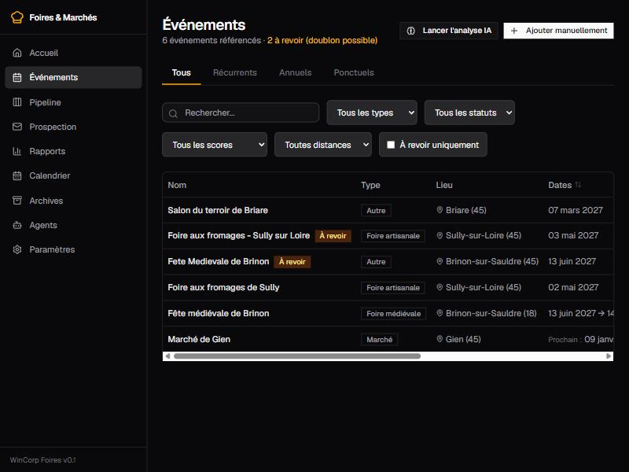
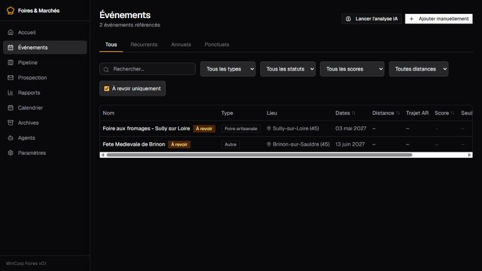
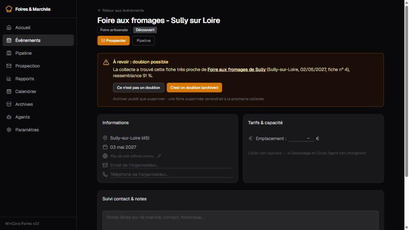
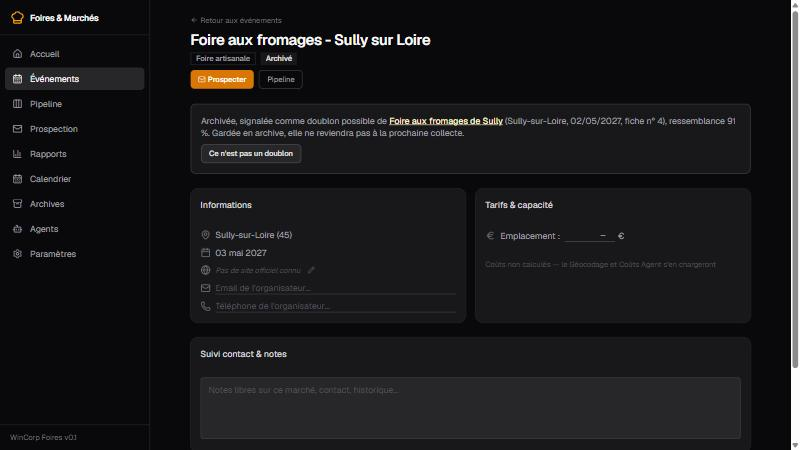
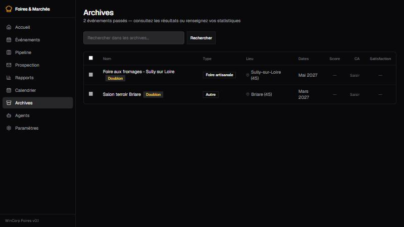

# Fiches « à revoir » : guide d'une page

Quand la collecte trouve un événement très proche d'une fiche déjà connue (nom et ville
ressemblants, dates proches), elle ne choisit pas à votre place : elle crée la fiche et la
marque **« À revoir »**.

## Les repérer

Dans **Événements**, le compteur sous le titre indique combien de fiches sont à revoir. Un clic
dessus, ou la case **À revoir uniquement**, n'affiche qu'elles. Chaque fiche concernée porte la
pastille orange **À revoir**.

## Les trancher

Ouvrez la fiche. L'encadré orange dit à quelle fiche elle ressemble (lien cliquable pour
comparer) et à quel point. Deux boutons :

- **Ce n'est pas un doublon** : la pastille disparaît, la fiche reste dans votre liste.
- **C'est un doublon (archiver)** : la fiche passe dans les archives. Elle ne reviendra pas
  à la prochaine collecte.

Une fiche archivée garde son signal : si elle a été archivée par erreur comme doublon, le
bouton **Ce n'est pas un doublon** reste disponible sur sa page.

## Pourquoi on ne peut pas la supprimer

Une fiche supprimée est oubliée : la collecte suivante la recréerait. La suppression d'une
fiche signalée est donc refusée avec un message ; utilisez **C'est un doublon** à la place.
Dans **Archives**, ces fiches portent la pastille **Doublon** et leur case de sélection est
grisée.

_Captures prises sur une base de test avec des données fictives._
